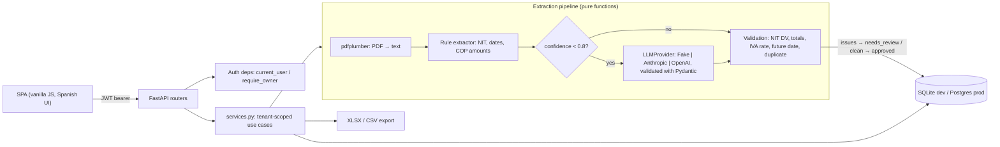
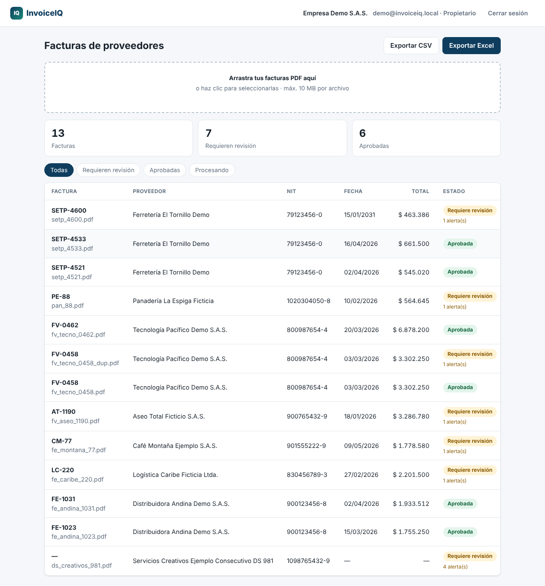
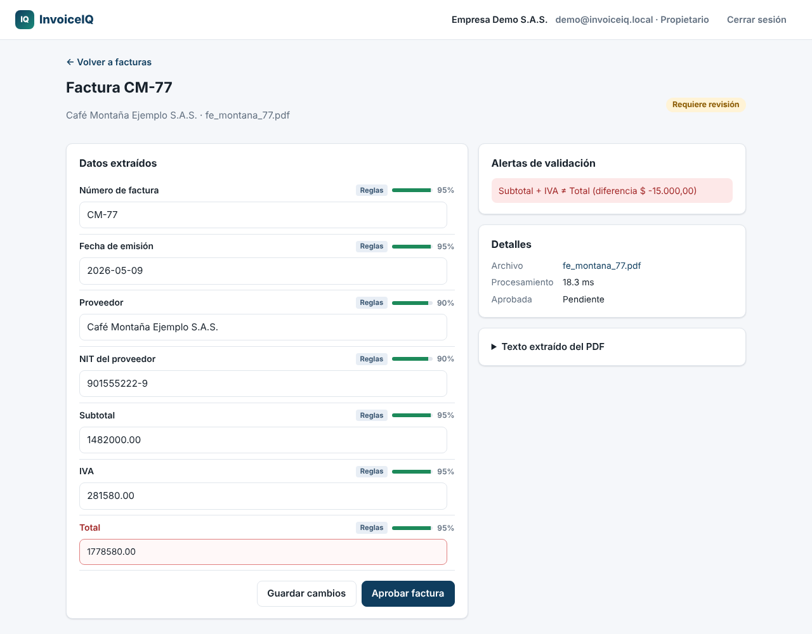

# InvoiceIQ

**Supplier invoice PDFs → validated, structured data.** A multi-tenant mini-SaaS for small
companies in Colombia/LatAm: upload supplier invoices, get invoice number, date, supplier,
NIT, subtotal, IVA and total extracted, validated against Colombian rules, reviewed by a
human when something looks wrong, and exported to Excel/CSV.

> Portfolio demo. All invoices, suppliers and NITs in this repo are fictional and generated
> by `scripts/make_invoices.py`. There are no real clients or production metrics here.

## Problem → outcome

Many small companies still receive supplier invoices as PDFs and have someone retype seven
fields per invoice into a spreadsheet. That is slow, and typos in a NIT or a total turn into
accounting and tax problems later.

InvoiceIQ:

- extracts the fields with deterministic rules first, using an LLM only for the fields the
  rules could not read with confidence;
- validates them: NIT check digit (DIAN algorithm), subtotal + IVA = total, legal IVA
  rate, no future dates, no duplicate invoice number per supplier;
- approves clean invoices automatically and sends the rest to a review queue that shows the
  reasons;
- exports approved invoices to XLSX or CSV.

## Architecture



```
invoiceiq/
├── api/            auth.py (signup, login, me, members) · invoices.py (upload, list, review, approve, export)
├── extraction/     colombia.py (NIT DV, COP, dates) · rules.py · llm.py · validation.py · pipeline.py
├── static/         index.html · app.js · styles.css   (no build step)
├── models.py       Organization, User, Invoice, InvoiceFile, ExtractionField
├── services.py     tenant-scoped use cases + exports
├── deps.py · security.py · config.py · db.py · main.py (app factory)
├── seed.py         local demo tenant
└── bench.py        extraction benchmark
scripts/            make_invoices.py (synthetic PDFs + ground truth) · screenshots.py
tests/              61 tests
```

## Design decisions

- **Rules first, LLM as fallback.** Colombian invoices follow regulated conventions: NIT
  with check digit, `dd/mm/yyyy` dates, `1.234.567,89` amounts, 19% IVA. Regexes anchored
  on labels handle these cheaply and repeatably, and each field gets a confidence score. Only
  fields that are missing or below the threshold go to the `LLMProvider`, together with the
  list of field names it should fill. That keeps cost and latency close to zero for common
  layouts while still covering unusual ones.
- **The model's output is not trusted.** The LLM answer goes through a Pydantic schema that
  parses dates, NIT and amounts with the same functions the rules use. If one field fails,
  only that field is dropped. LLM confidence is capped at 0.7, below the review threshold,
  so anything an LLM filled is always confirmed by a person.
- **Human-in-the-loop review.** Each field shows its source (Reglas / IA / Manual) and a
  confidence bar. Edits are normalised (you can type `$ 1.763.580,00`), stored as
  `source=human` and re-validated. Validation errors block approval; an **owner** can
  force-approve, and a **member** cannot.
- **Tenant isolation.** Every invoice query goes through `services.scoped_invoices(user)`.
  Another tenant's IDs return **404**, not 403, so they cannot be enumerated. JWTs carry the
  org id, and it is re-checked against the database on every request. Duplicate detection is
  also scoped per tenant. Tests cover each of these.
- **Stateless deploys.** Original PDFs are stored in their own table (`invoice_files`), so a
  deploy only needs Postgres. In production I would move them to S3/GCS with presigned URLs.
- **Deterministic by default.** The default `FakeProvider` never touches the network, which
  keeps tests, CI and the benchmark reproducible. Real providers use `httpx` with
  `trust_env=False` and are only built when both `INVOICEIQ_LLM_PROVIDER` and
  `INVOICEIQ_LLM_API_KEY` are set.

## Run it

```bash
make demo          # venv + install, generate samples, seed demo tenant, serve on :8000
```

Open http://localhost:8000 and log in with the **local-only** demo account that `seed`
creates:

| Email | Password |
|---|---|
| `demo@invoiceiq.local` | `demo-invoiceiq-2026` |

Other targets: `make test` (ruff + pytest), `make bench`, `make samples`, `make up`
(Docker Compose with Postgres). The API docs are at `/docs`.

| Endpoint | Purpose |
|---|---|
| `POST /api/auth/signup` · `POST /api/auth/login` · `GET /api/me` | Auth (signup creates the org and its owner) |
| `POST /api/users` | Owner adds a member to their org |
| `POST /api/invoices` | Upload a PDF (multipart), run the pipeline |
| `GET /api/invoices?status=needs_review` | List and filter |
| `GET /api/invoices/{id}` · `GET /api/invoices/{id}/file` | Detail · original PDF |
| `PATCH /api/invoices/{id}/fields` | Human corrections (re-validated) |
| `POST /api/invoices/{id}/approve` | Approve (`{"force": true}` for owners only) |
| `GET /api/invoices/export?format=xlsx\|csv` | Export approved invoices |

## Deploy

- **Docker:** non-root image (`uid 10001`) with a health check that serves on `$PORT`.
  `docker compose up --build` starts Postgres 16 and the app, and seeds the demo tenant.
- **Render:** `render.yaml` blueprint with a Docker web service and managed Postgres.
  `INVOICEIQ_SECRET_KEY` is generated by Render.
- **Fly.io:** `fly.toml` example. Attach Fly Postgres to get `DATABASE_URL`, then run
  `fly secrets set INVOICEIQ_SECRET_KEY=…`.
- `DATABASE_URL` values in `postgres://` form are normalised to `psycopg`. The app **refuses
  to start** on a non-SQLite database while the default secret key is still set.
- **CI:** `.github/workflows/ci.yml` runs ruff, pytest on Python 3.11 and 3.12, and the
  offline benchmark, then builds the Docker image.

Configuration lives in `.env.example`.

## Benchmark

`python -m invoiceiq.bench` runs the same pipeline the API uses over `data/samples/` and
compares the output with `ground_truth.json`. The numbers below are from my run on
2026-10-14 (Python 3.13, Linux sandbox). Full output: [`bench/results.json`](bench/results.json).

**Dataset: 13 synthetic sample invoices. LLM fallback: FakeProvider (offline, returns no
values).**

| Metric | Result |
|---|---|
| Invoices | 13: 12 on 3 layouts the rules target + 1 off-template "documento soporte" |
| Field accuracy (7 fields × 13 invoices) | **94.5%** (86/91) |
| Per field | NIT 100% · IVA 100% · number, date, supplier, subtotal, total 92.3% each |
| Invoices fully extracted by rules alone | **12/13 (92.3%)** |
| Review routing correct (flagged vs. auto-approved) | **13/13** (7 should be flagged) |
| Validation error codes exactly as expected | 13/13 |
| Sent to LLM fallback | 1 invoice, 4 fields requested, 0 filled (FakeProvider) |
| Avg processing time (PDF text + rules + validation) | **25.1 ms/invoice** (max 30.0 ms) |

How to read these numbers:

- The rules were written while looking at these templates. Near-perfect accuracy on them
  shows that the pipeline works end to end. It does **not** predict accuracy on real
  supplier PDFs.
- The off-template document shows the failure modes. The rules leave four fields empty,
  which is correct behaviour because it sends the invoice to review. They also return a
  wrong supplier name with 0.82 confidence, which passes the threshold. A real LLM provider,
  or a per-supplier layout memory, would address both.
- The deliberately broken invoices cover each validation path once: 2 invalid NIT check
  digits, 2 totals that don't add up, 1 duplicate, 1 future date and 1 with missing fields.
  All 7 were routed to review, and the 6 clean invoices were auto-approved.

## Screenshots

Captured with Playwright from the seeded demo (`scripts/screenshots.py`).

| Invoice list | Review screen |
|---|---|
|  |  |

## Tests

**61 tests** (`pytest`): NIT check digits, COP amount and date parsing, rule extraction on
the generated samples, every validation rule, the LLM fallback (merge, confidence cap,
per-field rejection, Anthropic/OpenAI request and response handling through
`httpx.MockTransport` with no network), auth (hashing, bad tokens, roles), tenant
isolation, and the full upload → review → edit → approve → XLSX/CSV export flow through
FastAPI's `TestClient`.

## Limitations / next steps

- The PDFs must have a text layer. Scanned images would need OCR (Tesseract, or a vision
  LLM) before the rules run.
- Single page, one invoice per PDF. No line-item extraction.
- Processing runs synchronously inside the request. In production it would go to a queue
  (RQ, Celery or Cloud Tasks), and the `processing` status is already modelled for that.
- `create_all` instead of Alembic migrations. Fine for a demo, not for a product that evolves.
- No DIAN XML (UBL 2.1) ingestion yet. For Colombian *factura electrónica* that is the
  more reliable source, and the PDF path would become the fallback.

---

## Resumen en español

**InvoiceIQ** es un mini-SaaS multiempresa que convierte facturas de proveedores en PDF en
datos estructurados y validados: número, fecha, proveedor, NIT, subtotal, IVA y total.

- **Extracción híbrida:** primero reglas deterministas (NIT con dígito de verificación DIAN,
  fechas `dd/mm/aaaa`, montos en COP `1.234.567,89`). Solo los campos con baja confianza
  van a un LLM (Anthropic u OpenAI), y su respuesta se valida con Pydantic. Por defecto se
  usa un proveedor *fake* sin red.
- **Validación:** NIT válido, subtotal + IVA = total, tarifa de IVA legal (0/5/19%), fecha
  no futura y factura no duplicada por proveedor. Si algo falla, la factura queda en
  **"Requiere revisión"** con los motivos. Si todo está bien, se aprueba sola.
- **Revisión humana:** cada campo muestra su origen (Reglas / IA / Manual) y su confianza.
  Las correcciones se revalidan. Solo el propietario puede forzar una aprobación.
- **Seguridad:** JWT, contraseñas con bcrypt y aislamiento por organización (pruebas
  incluidas).
- **Exportación:** Excel y CSV de las facturas aprobadas.
- **Resultados medidos (demo con 13 facturas sintéticas, sin LLM real):** 94,5 % de
  precisión por campo, 12/13 facturas extraídas solo con reglas, 13/13 enrutadas
  correctamente a revisión o aprobación, unos 25 ms por factura y 61 pruebas automatizadas.
- **Ejecutar:** `make demo` y luego abrir http://localhost:8000 con
  `demo@invoiceiq.local` / `demo-invoiceiq-2026` (solo local).
